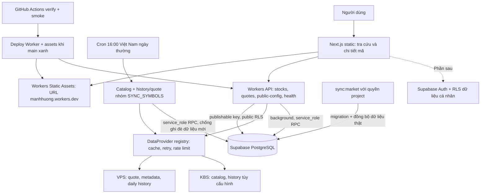

# Kiến trúc Phần 1–2

Next.js `output: export` phục vụ trang chủ và `/stocks?symbol=VNM`; trang chi tiết
client fetch dữ liệu thật, không fetch provider lúc build, không load fixture production.
Workers Static Assets gắn `web/out` vào URL Worker hiện có, không cần Pages riêng.
Pages vẫn là lựa chọn deployment bổ sung. SSR/server actions nếu cần ở phần sau
sẽ cần adapter khác.

API tra cứu kiểm tra input/mã đã đăng ký HOSE/HNX/UPCOM, public SELECT bằng
publishable key. Chỉ background cache/Cron dùng secret service_role gọi RPC ingest;
không có endpoint HTTP cho thao tác private hoặc quyền admin. Các RPC ghi chỉ
EXECUTE cho service_role, SECURITY INVOKER, empty search_path. Payload lỗi/credential
không đưa vào trạng thái public. `/v1/public-config` chỉ xuất key sb_publishable,
không xuất service_role/sb_secret. Các key thật không có trong GitHub.

Catalog mặc định KBS vì endpoint danh mục VPS đang lỗi trong khảo sát; quote/profile
và OHLCV ngày VPS đã gọi thật. History có thể cấu hình KBS; provenance lưu mỗi bar,
không fallback ngầm hay trộn nguồn. Cache bounded 100 entry/isolate: quote 15s,
history 15 phút, catalog/profile 24h. Request cách nhau 1s, batch tối đa 50,
timeout 25s, retry có backoff/Retry-After, không retry 401/403/schema lỗi.

History giá VND, volume cổ phiếu đã đối soát VNM/FPT/HPG một phiên; giữ
price_basis=unverified, tách bảng prices_history khỏi prices_daily và scoring.
Không tạo bar cuối tuần/ngày nghỉ, không điền ngày thiếu, không biến snapshot thành
OHLCV. Ngày phiên dùng Asia/Ho_Chi_Minh; bar hôm nay không final vì chưa có lịch
đóng phiên có nguồn. MA20/50/200 tính trên close cùng nguồn, chỉ xuất khi đủ nến.

Cron mới `0 9 * * 1-5` chạy 16:00 VN để cập nhật catalog và SYNC_SYMBOLS (mặc định
VNM/FPT/HPG). Đây là lịch lấy dữ liệu, không khẳng định giờ đóng cửa; ngày nghỉ có
thể đọc lại history mà không tạo phiên. Ghi success chỉ sau toàn bộ dữ liệu hợp lệ
và ghi DB thành công. Ingest nhiều mã chưa phải transaction toàn thị trường.
Cron cũ `30 8 * * 1-5` chỉ lưu snapshot sau khi trading_sessions/closes_at đã
xác minh cho ngày đó; thiếu lịch thì bỏ tải. Không tự tạo lịch nghỉ lễ hoặc phiên.

## Database

| Bảng             | Mục đích / khóa                                         | Quyền client   |
| ---------------- | ------------------------------------------------------- | -------------- |
| stocks           | Danh mục mã + sàn HOSE/HNX/UPCOM; unique symbol         | Công khai đọc  |
| trading_sessions | Lịch có nguồn, verified_at, đóng phiên theo VN          | Công khai đọc  |
| prices_current   | Snapshot giá VND; lot × 10 (ACB 1 ngày), lastVolume raw | Công khai đọc  |
| prices_history   | OHLCV nguồn/basis unverified, fetched_at, is_final      | Công khai đọc  |
| prices_daily     | OHLCV theo mã/ngày/price_basis; chưa có nguồn ingest    | Công khai đọc  |
| fundamentals     | Mã/kỳ/annual-ttm-quarter, EPS/BVPS VND, FCFE VND        | Công khai đọc  |
| scores           | Mã/ngày/horizon/model, null nếu thiếu dữ liệu           | Công khai đọc  |
| rankings         | Ngày/day-month-quarter/model/rank, FK cùng score        | Công khai đọc  |
| news_articles    | URL HTTPS unique, thời điểm xuất bản, mã tùy chọn       | Công khai đọc  |
| news_sentiment   | Article/model, score -1..1, confidence 0..1             | Công khai đọc  |
| system_status    | Trạng thái public an toàn, last_success_at              | Công khai đọc  |
| watchlists       | Owner/id, owner/name unique                             | RLS theo owner |
| watchlist_items  | Owner + FK ghép tới watchlist của chính owner           | RLS theo owner |
| alerts           | Owner, mã, ngưỡng; FK ghép nếu gắn watchlist            | RLS theo owner |
| user_settings    | Owner PK, timezone Việt Nam, horizon mặc định           | RLS theo owner |

Tất cả bảng bật ENABLE/FORCE RLS. `anon`/`authenticated` chỉ SELECT bảng thị trường;
không có quyền ghi thị trường hay gọi RPC ingest. Policy private dùng cả USING và
WITH CHECK với `auth.uid()`, chặn đổi owner và giả owner lúc INSERT. FK ghép chặn
gắn item/alert vào watchlist của người khác. Index theo owner, mã/ngày, kỳ xuất bản,
horizon/rank, thời điểm tin và alerts đang bật. Supabase service_role bypass RLS,
chỉ nằm trong Worker secret; admin/project owner cũng có quyền quản trị database.

## Công thức và ranh giới Phần 1

Cấu hình `VPS_LOT_SIZE=10` chỉ chuyển `lot` thành tổng cổ phiếu theo bằng chứng
ACB 12/10/2026 (1 mã, cần đối chiếu thêm); `lastVolume` giữ raw, test pending,
không dùng scoring/rankings. Cột generated của database giữ cùng hệ số.

Các hàm toán độc lập chỉ được thêm để đáp ứng kiểm thử nền tảng. Chưa có chiến lược
chấm điểm thật, DCF dự báo thật, tin tức, dashboard, alert delivery hoặc ranking job.

- Graham = sqrt(22.5 × EPS annual/TTM × BVPS); adapter từ chối EPS quý.
- Biên an toàn = 1 - market / intrinsic, dạng fraction, có thể âm.
- DCF dùng **FCFE**, discount rate vốn chủ và Gordon terminal;
  không trộn FCFF/WACC hay bỏ nợ trong định giá vốn chủ. Rate > growth > -1.
- RSI/ATR dùng Wilder; MACD dùng EMA seed SMA, signal EMA; Fibonacci là retracement
  nhịp tăng, tính từ đỉnh xuống. RSI chuỗi phẳng =100 theo thư viện tham chiếu,
  một quy ước có thể khác nền tảng khác.
- Thiếu dữ liệu/NaN/Infinity/đầu vào không hợp lệ trả `{ok:false,reason:'không đủ dữ liệu'}`.
  Không dùng MIN/MAX price basis chưa xác minh của quote hiện tại cho chỉ báo lịch sử.

Xem [data-sources.md](data-sources.md) để biết điều đã đối chiếu và còn thiếu.
