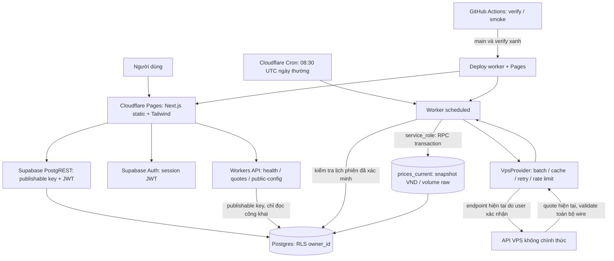

# Kiến trúc Phần 1

Web xuất trang tĩnh bằng Next.js `output: export`; không có Next server ở
Cloudflare Pages. SSR/server actions nếu cần ở phần sau sẽ cần kiến trúc và adapter
khác. Trang hiện tại hiển thị hello world tiếng Việt, cảnh báo tham khảo và nút
kiểm tra kết nối: health Worker, ba bảng thị trường công khai ở Supabase, snapshot
ACB qua Worker. Nút này không ghi dữ liệu, không phải dashboard phân tích.

Workers API có `GET /health` và `GET /v1/quotes?symbols=ACB,BID`. Route quotes chỉ đọc
snapshot dùng Supabase publishable key; không nhận service key/JWT từ client để
tự nâng quyền. Dữ liệu riêng được truy cập qua Supabase Auth + RLS khi UI được xây
ở phần sau. Chưa có luồng đăng nhập hay quản lý watchlist trên giao diện Phần 1.

`GET /v1/public-config` xuất URL Supabase và key `sb_publishable_*` đã đặt trong
Worker để browser lấy cấu hình lúc chạy, có CORS và không cache. Không trả service
role hay `sb_secret_*`; biến publishable đặt nhầm loại key bị chặn. URL mặc định
do người dùng cung cấp nằm ở `config/public-deployment.json`, env có thể ghi đè;
key thật không hard-code vào GitHub. Publishable key công khai không thay thế RLS.
Health xanh không chứng minh migration hosted, snapshot hay Cron đã hoạt động.

Cron `30 8 * * 1-5` chạy 15:30 giờ Việt Nam. Đây là lựa chọn vận hành, không phải
khẳng định giờ giao dịch đã xác minh cho mọi sàn. Worker kiểm tra `trading_sessions`
và `closes_at` trước khi chạy, kể cả ngày nghỉ lễ hoặc phiên đóng sớm; thiếu lịch
thì bỏ tải. Lịch và danh sách mã/sàn phải được nhập từ nguồn được xác nhận. Không
seed từ fixture, không suy luận sàn từ `mc`. Không có lịch → không ghi nhận success.

VpsProvider chỉ lấy **quote hiện tại**, có cache 15s, batch <=50, retry và giới hạn
gọi trong isolate. Snapshot không được chuyển thành OHLCV hay dùng cho ATR/RSI/MACD
khi chưa rõ price basis/ngày phiên. Cron sau phiên vẫn chỉ lưu snapshot nhận được,
không khẳng định đó là giá đóng cửa. Thiếu timestamp sàn được thể hiện rõ trong API.

RPC `ingest_current_quotes` dùng SECURITY INVOKER, chỉ service_role có EXECUTE.
Mỗi batch là một transaction; mã chưa đăng ký hoặc sai constraint làm rollback.
Snapshot cũ hơn không ghi đè snapshot mới. Trạng thái success chỉ cập nhật sau khi
toàn bộ các batch hoàn tất. Nhiều batch chưa phải một transaction toàn bộ thị trường;
client phải kiểm tra `system_status` và `fetched_at` để phát hiện dữ liệu chưa đồng bộ.
Không lưu payload lỗi/credential trong bảng trạng thái công khai.

## Database

| Bảng             | Mục đích / khóa                                         | Quyền client   |
| ---------------- | ------------------------------------------------------- | -------------- |
| stocks           | Danh mục mã + sàn HOSE/HNX/UPCOM; unique symbol         | Công khai đọc  |
| trading_sessions | Lịch có nguồn, verified_at, đóng phiên theo VN          | Công khai đọc  |
| prices_current   | Snapshot giá VND; lot × 10 (ACB 1 ngày), lastVolume raw | Công khai đọc  |
| prices_daily     | OHLCV theo mã/ngày/price_basis; chưa có nguồn ingest    | Công khai đọc  |
| fundamentals     | Mã/kỳ/annual-ttm-quarter, EPS/BVPS VND, FCFE VND        | Công khai đọc  |
| scores           | Mã/ngày/horizon/model, null nếu thiếu dữ liệu           | Công khai đọc  |
| rankings         | Ngày/day-month-quarter/model/rank, FK cùng score        | Công khai đọc  |
| news_articles    | URL HTTPS unique, thời điểm xuất bản, mã tùy chọn       | Công khai đọc  |
| news_sentiment   | Article/model, score -1..1, confidence 0..1             | Công khai đọc  |
| system_status    | Trạng thái public an toàn, last_success_at              | Công khai đọc  |
| watchlists       | Owner/id, owner/name unique                             | RLS theo owner |
| watchlist_items  | Owner + FK ghép tới watchlist của chính owner           | RLS theo owner |
| alerts           | Owner, mã, ngưỡng; FK ghép nếu gắn watchlist            | RLS theo owner |
| user_settings    | Owner PK, timezone Việt Nam, horizon mặc định           | RLS theo owner |

Tất cả bảng bật ENABLE/FORCE RLS. `anon`/`authenticated` chỉ SELECT bảng thị trường;
không có quyền ghi thị trường hay gọi RPC ingest. Policy private dùng cả USING và
WITH CHECK với `auth.uid()`, chặn đổi owner và giả owner lúc INSERT. FK ghép chặn
gắn item/alert vào watchlist của người khác. Index theo owner, mã/ngày, kỳ xuất bản,
horizon/rank, thời điểm tin và alerts đang bật. Supabase service_role bypass RLS,
chỉ nằm trong Worker secret; admin/project owner cũng có quyền quản trị database.

## Công thức và ranh giới Phần 1

Cấu hình `VPS_LOT_SIZE=10` chỉ chuyển `lot` thành tổng cổ phiếu theo bằng chứng
ACB 12/10/2026 (1 mã, cần đối chiếu thêm); `lastVolume` giữ raw, test pending,
không dùng scoring/rankings. Cột generated của database giữ cùng hệ số.

Các hàm toán độc lập chỉ được thêm để đáp ứng kiểm thử nền tảng. Chưa có chiến lược
chấm điểm thật, DCF dự báo thật, tin tức, dashboard, alert delivery hoặc ranking job.

- Graham = sqrt(22.5 × EPS annual/TTM × BVPS); adapter từ chối EPS quý.
- Biên an toàn = 1 - market / intrinsic, dạng fraction, có thể âm.
- DCF dùng **FCFE**, discount rate vốn chủ và Gordon terminal;
  không trộn FCFF/WACC hay bỏ nợ trong định giá vốn chủ. Rate > growth > -1.
- RSI/ATR dùng Wilder; MACD dùng EMA seed SMA, signal EMA; Fibonacci là retracement
  nhịp tăng, tính từ đỉnh xuống. RSI chuỗi phẳng =100 theo thư viện tham chiếu,
  một quy ước có thể khác nền tảng khác.
- Thiếu dữ liệu/NaN/Infinity/đầu vào không hợp lệ trả `{ok:false,reason:'không đủ dữ liệu'}`.
  Không dùng MIN/MAX price basis chưa xác minh của quote hiện tại cho chỉ báo lịch sử.

Xem [data-sources.md](data-sources.md) để biết điều đã đối chiếu và còn thiếu.
